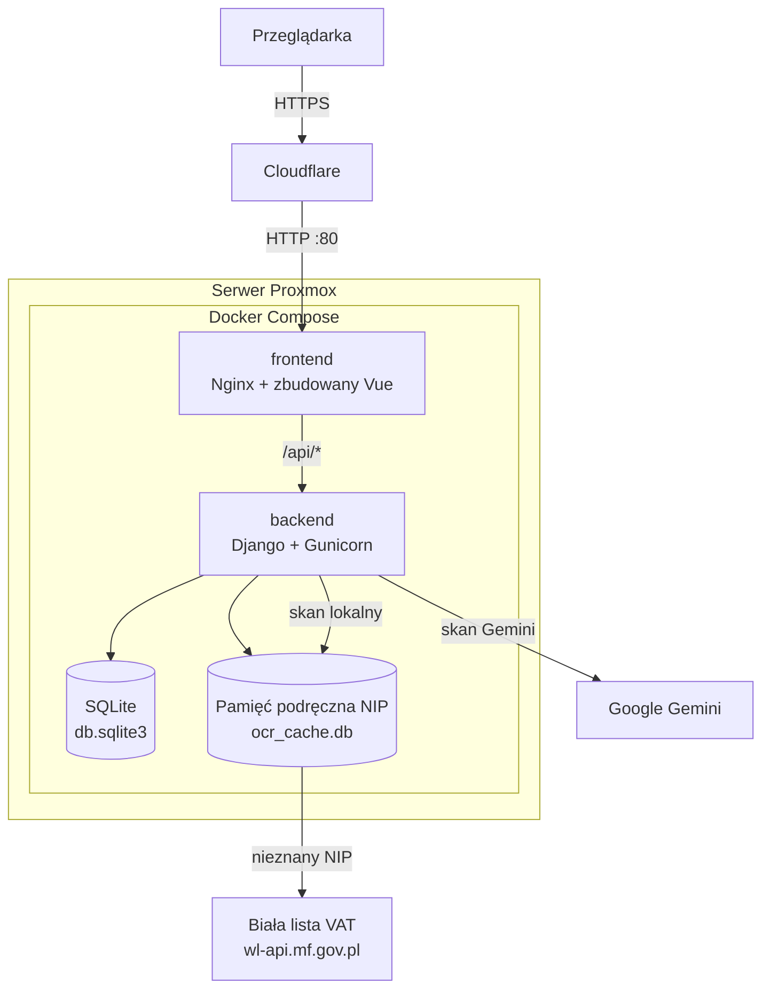

# Aplikacja webowa do śledzenia wydatków i skanowania paragonów

Aplikacja webowa oparta na **Django** i **Vue 3**, wykorzystująca **EasyOCR** oraz **Google Gemini** do odczytu paragonów i prowadzenia osobistego budżetu.

**Aplikacja online:** [https://wydatki.mkuzownik.tech/](https://wydatki.mkuzownik.tech/)

---

## Spis treści

- [Opis projektu](#opis-projektu)
- [Funkcjonalności](#funkcjonalności)
- [Technologie](#technologie)
- [Hosting](#hosting)
- [Struktura projektu](#struktura-projektu)
- [Architektura](#architektura)
- [Skan paragonów](#skan-paragonów)
- [Tryb gościa](#tryb-gościa)

---

## Opis projektu

Użytkownik prowadzi listę wydatków, ogląda podsumowanie wybranego miesiąca i może wgrać zdjęcie paragonu. System odczytuje sklep, pozycje i kwoty — wynik da się poprawić przed zapisem. Każde konto ma własne wydatki i kategorie.

Aplikację można też używać **bez rejestracji** (tryb gościa): dane trzymane są w `localStorage` przeglądarki, a skan paragonów działa przez te same endpointy API z limitami zapytań.

Nowe konto dostaje **10 kategorii**:

| Kategoria | Opis |
|-----------|------|
| Jedzenie | Zakupy spożywcze, restauracje |
| Transport | Paliwo, bilety, przejazdy |
| Mieszkanie | Czynsz, media |
| Rozrywka | Wyjścia, subskrypcje |
| Zdrowie i uroda | Apteka, kosmetyki |
| Edukacja | Kursy, książki |
| Ubrania | Odzież i obuwie |
| Wydatki domowe | Chemia, wyposażenie |
| Prezenty | Okazje |
| Inne | Pozostałe wydatki |

Własne kategorie można dodać z formularza wydatku.

---

## Funkcjonalności

- **Konta i sesja** — rejestracja, logowanie, ciche odświeżanie tokenu; blokada po 10 nieudanych próbach na 15 minut; **tryb gościa** bez logowania
- **Wydatki** — dodawanie, edycja i usuwanie (nazwa, kwota, data, kategoria); filtr miesiąca i roku
- **Pozycje paragonu** — podgląd, poprawka, usunięcie i podział na pół; suma wydatku przelicza się od nowa
- **Podsumowania** — wydatki miesiąca, średnia dzienna, prognoza, największy wydatek i limit budżetu
- **Wykresy** — kołowy udział kategorii oraz słupkowy wg dni tygodnia, miesięcy albo lat
- **Skan paragonu** — EasyOCR (lokalnie) albo Gemini; wybór pozycji i kategorii przed zapisem
- **Motyw** — jasny i ciemny

| Metoda | Ścieżka | Dostęp | Opis |
|--------|---------|--------|------|
| `POST` | `/api/register/` | publiczny | Rejestracja |
| `POST` | `/api/token/` | publiczny | Logowanie |
| `POST` | `/api/token/refresh/` | ciasteczko | Nowy access token |
| `POST` | `/api/logout/` | publiczny | Wylogowanie |
| `GET`, `POST` | `/api/expenses/` | zalogowany | Lista i tworzenie wydatków |
| `GET`, `PUT`, `PATCH`, `DELETE` | `/api/expenses/<id>/` | zalogowany | Pojedynczy wydatek |
| `GET`, `POST` | `/api/categories/` | zalogowany | Lista i tworzenie kategorii |
| `POST` | `/api/scan/` | publiczny (rate limit) | Skan EasyOCR |
| `POST` | `/api/scan-gemini/` | publiczny (rate limit) | Skan Gemini |

Panel Django jest pod ścieżką `/admin-console-67/`.

---

## Technologie

| Warstwa | Stack |
|---------|--------|
| Frontend | Vue 3, Vite, Axios, Chart.js |
| Backend | Python 3.12, Django 6, Django REST Framework |
| Uwierzytelnianie | SimpleJWT, django-axes |
| OCR lokalny | EasyOCR, OpenCV, PyTorch (CPU) |
| OCR w chmurze | Google Gemini (`google-genai`) |
| Baza danych | SQLite |
| Produkcja | Gunicorn, Nginx, WhiteNoise, Docker Compose |

---

## Hosting

Aplikacja jest dostępna pod adresem **[https://wydatki.mkuzownik.tech/](https://wydatki.mkuzownik.tech/)**.

Hostowana jest na własnym serwerze **Proxmox**, w dwóch kontenerach **Docker** (Nginx ze zbudowanym Vue oraz Gunicorn z Django), z konfiguracją proxy / Cloudflare (HTTPS, `CSRF_TRUSTED_ORIGINS`, `SECURE_PROXY_SSL_HEADER`).

---

## Struktura projektu

<details>
<summary>Rozwiń pełną strukturę katalogów</summary>

```
Expense_tracker/
├── docker-compose.yml              # Orkiestracja frontendu i backendu
├── Dockerfile                      # Obraz backendu (Gunicorn)
├── requirements.txt                # Zależności Pythona
├── manage.py
├── README.md
├── core/                           # Konfiguracja projektu Django
│   ├── settings.py
│   ├── urls.py                     # Auth, API, panel administracyjny
│   ├── wsgi.py
│   └── asgi.py
├── expenses/                       # Aplikacja wydatków
│   ├── models.py                   # Category, Expense
│   ├── serializers.py
│   ├── views.py                    # CRUD, JWT w ciasteczku, skan
│   ├── urls.py
│   ├── admin.py
│   └── migrations/
├── ocr/                            # Odczyt paragonów
│   ├── easyocr_processor.py        # OCR lokalny, NIP, pozycje
│   ├── gemini_processor.py         # OCR przez Gemini
│   └── ocr_processor.py
└── expense-frontend/               # Aplikacja Vue
    ├── Dockerfile                  # Build Vite + Nginx
    ├── nginx.conf                  # SPA i proxy /api/
    ├── package.json
    ├── vite.config.js
    └── src/
        ├── main.js
        ├── App.vue                 # Sesja / gość, miesiąc, modale
        ├── api.js                  # Axios, refresh tokenu, FormData
        ├── guestStore.js           # Wydatki i kategorie gościa (localStorage)
        ├── dataService.js          # API lub localStorage wg trybu
        ├── style.css
        └── components/
            ├── LoginModal.vue
            ├── AppHeader.vue
            ├── ExpenseForm.vue
            ├── ExpenseList.vue
            ├── ExpenseStats.vue
            ├── ExpenseCharts.vue
            └── ScannerForm.vue
```

</details>

---

## Architektura

### Przepływ żądania



### Aplikacje

| Część | Rola |
|-------|------|
| `core` | Ustawienia, routing, limity zapytań, CORS, bezpieczeństwo za proxy |
| `expenses` | Modele, API wydatków i kategorii, sesja, endpointy skanu |
| `ocr` | Przetwarzanie obrazu paragonu i zwrot struktury JSON |
| `expense-frontend` | Interfejs: lista, statystyki, wykresy, formularz, skaner |

### Model danych

- `Category` — nazwa unikalna w obrębie użytkownika
- `Expense` — nazwa, kwota, data, kategoria (opcjonalna) i pole JSON `items` z pozycjami paragonu
- Usunięcie kategorii nie kasuje wydatków: pole kategorii zostaje puste

### Uwierzytelnianie

1. `POST /api/token/` zwraca access token w JSON i ustawia refresh token w ciasteczku `HttpOnly` (ścieżka `/api/token/refresh/`).
2. Axios trzyma access token w pamięci i dokleja nagłówek `Authorization: Bearer`.
3. Przy odpowiedzi 401 woła odświeżenie i powtarza pierwotne żądanie.
4. django-axes blokuje logowanie po 10 nieudanych próbach. Adres klienta jest czytany z uwzględnieniem dwóch proxy (Cloudflare i Nginx).

Limity API (domyślnie): 30 żądań/min dla anonimowych klientów, 60/min dla zalogowanych; skan EasyOCR **5/min**, skan Gemini **3/min** (liczone po adresie IP lub ID użytkownika).

W developmencie frontend Vite często działa na porcie **5173** lub **5174** — origin musi być w `CORS_ALLOWED_ORIGINS` w pliku `.env` (np. `http://localhost:5174`).

### Frontend

- Jednostronicowa aplikacja Vue 3, serwowana przez Nginx
- Wykresy Chart.js (`ExpenseCharts.vue`), karty budżetu (`ExpenseStats.vue`)
- Klient HTTP w `api.js` (ciasteczka, kolejka żądań w trakcie odświeżania tokenu)
- Limit miesięczny trzymany w `localStorage` przeglądarki

### Wdrożenie

```
Internet → Cloudflare (HTTPS) → Proxmox → Docker Compose
                                              ├── frontend  Nginx :80
                                              └── backend   Gunicorn :8000
```

Kontenery budowane z `Dockerfile` (backend, `python:3.12-slim`, 3 workery) oraz `expense-frontend/Dockerfile` (build Node 20, potem `nginx:alpine`). Baza to plik SQLite (`db.sqlite3`).

---

## Skan paragonów

Zdjęcie w polu `receipt` jest zapisywane tymczasowo, przetwarzane i usuwane niezależnie od wyniku. Odpowiedź zawiera NIP, nazwę sklepu, sumę i listę produktów (`name`, `amount`). Endpointy skanu są dostępne **bez JWT**; chroni je rate limiting (patrz [Uwierzytelnianie](#uwierzytelnianie)).

| Silnik | Endpoint | Gdzie liczy | Opis |
|--------|----------|-------------|------|
| EasyOCR | `/api/scan/` | serwer (CPU) | Przycięcie obrazu, odczyt linii, parser pozycji i opustów, walidacja NIP |
| Gemini | `/api/scan-gemini/` | Google Gemini | Model zwraca JSON; opust jest odejmowany od pozycji, której dotyczy |

Przy skanie lokalnym nazwa sklepu pochodzi z pamięci podręcznej (`ocr/ocr_cache.db`) albo z [białej listy VAT](https://wl-api.mf.gov.pl/) Ministerstwa Finansów. Znane sieci (m.in. Biedronka, Lidl, Kaufland) są mapowane na krótką nazwę.

### Gemini — modele i optymalizacja obrazu

W `ocr/gemini_processor.py` używana jest kolejność modeli (pierwszy udany wygrywa):

1. `gemini-3.6-flash`
2. `gemini-3.5-flash`
3. `gemini-3.8-flash`
4. `gemini-flash-latest`
5. `gemini-3.1-flash-lite`

Przy błędach przejściowych (np. 503, 429) następuje krótka pauza i próba kolejnego modelu. W odpowiedzi API pole `model` wskazuje, który model zadziałał.

Aby przyspieszyć analizę, zdjęcie jest zmniejszane przed wysłaniem do API:

| Miejsce | Plik | Domyślnie |
|---------|------|-----------|
| Przeglądarka (tylko ścieżka Gemini) | `ScannerForm.vue` → `compressReceiptImage()` | dłuższy bok max **1600 px**, JPEG jakość **0.85** |
| Backend | `gemini_processor.py` → `_prepare_receipt_image()` | dłuższy bok max **1600 px** (`GEMINI_MAX_IMAGE_SIDE` w `.env`) |

Wymaga klucza `GEMINI_API_KEY` w `.env`.

Typowy czas odpowiedzi Gemini: ok. **3–15 s** (zależy od rozmiaru zdjęcia, obciążenia API i liczby prób modeli).

---

## Tryb gościa

Użytkownik może wybrać **„Kontynuuj jako gość”** na ekranie logowania.

| Aspekt | Zachowanie |
|--------|------------|
| Przechowywanie | `localStorage`: `guest_expenses`, `guest_categories`, `expense_auth_mode=guest` |
| Logika frontendu | `guestStore.js` + `dataService.js` (te same komponenty co po logowaniu) |
| Skan paragonów | Tak — wynik zapisywany lokalnie jak ręczny wydatek |
| API wydatków / kategorii | Bez tokenu — tylko tryb gościa w UI; zapis po stronie przeglądarki |
| Po zalogowaniu | Widoczne dane z serwera; dane gościa zostają w przeglądarce do kolejnej sesji gościa |

Dane gościa **nie znikają po zamknięciu przeglądarki** (chyba że użytkownik wyczyści dane strony lub używa trybu prywatnego). **Nie ma synchronizacji** między urządzeniami ani automatycznego przenoszenia wydatków gościa na konto po rejestracji.
